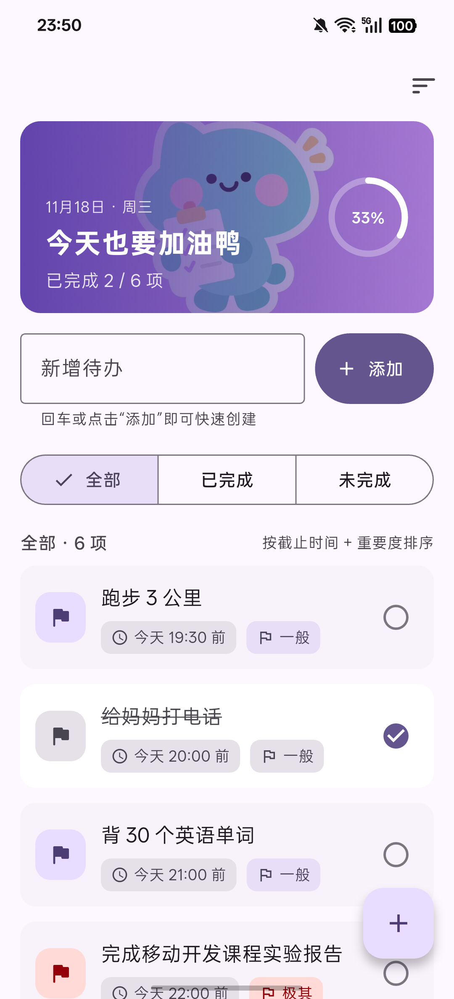
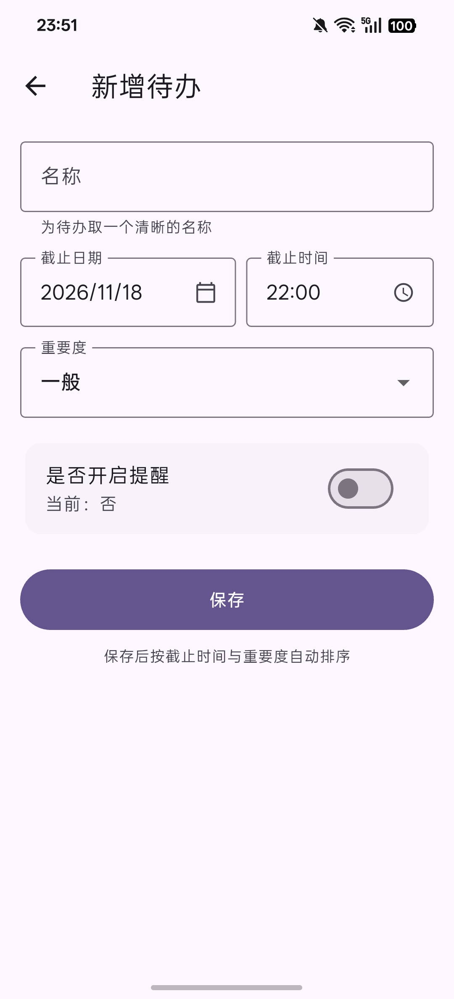
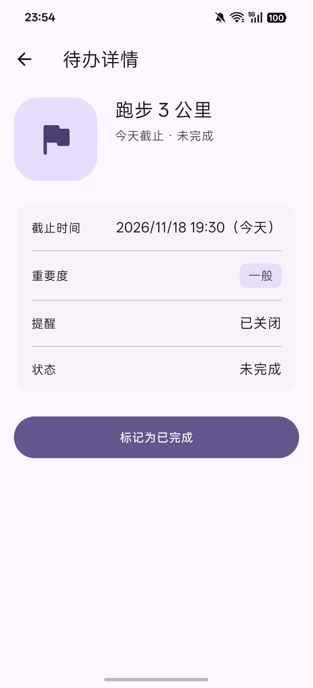
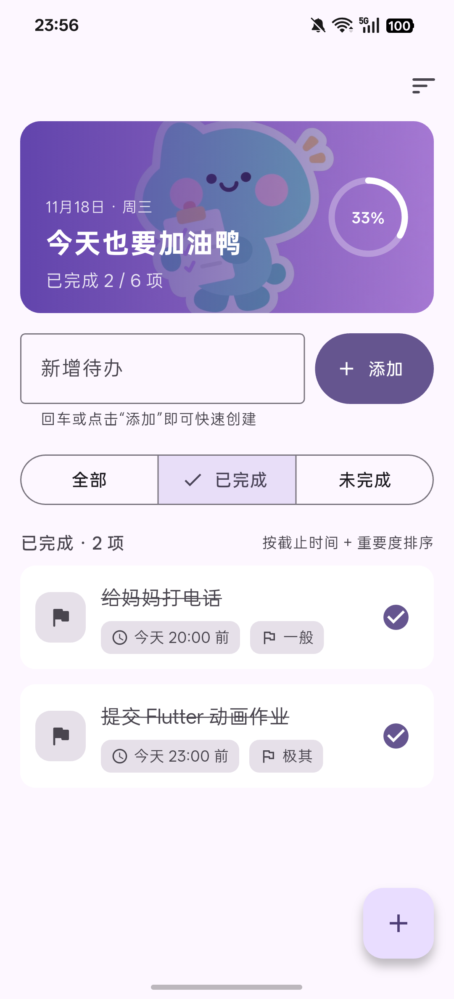

<div align="center">


# Due · 当务

**当务之急，趁早做完**

Material 3 风格的待办清单 App · Flutter 真机实现 + 高保真 HTML 原型

`Material 3` · `Flutter` · `Android APK` · `390 × 844` · `v1.2.0`

</div>

---

## 📱 应用介绍

**Due · 当务** 是一款以「截止时间」为核心的待办清单应用。它不追求堆叠功能，而是帮你回答一个问题：**现在最该做哪件事？**

列表按截止时间自动排序，时间越近越靠前；同一时刻，重要度高的任务优先。完成的每一件小事都会推进进度环，配合动态日期与每日激励插画，让「趁早做完」变成一种轻量的日常。

界面严格对齐 Flutter 官方默认的 Material 3 规范，颜色、文字、形状全部使用 M3 默认 Token，并已用 Flutter 实现为可在真机安装运行的 Android App。

---

## ✨ 核心功能

| 功能 | 说明 |
|---|---|
| ⏰ **智能排序** | 按截止日期 + 时间升序，越接近当前时间越靠前；同一时刻重要度「极其」优先 |
| 📅 **灵活截止时间** | 日期可任选，不局限于当天；列表以「今天 / 明天 / 11月20日」相对展示 |
| ➕ **快速新增** | 首页输入框回车即建，默认今天 22:00；也可进入完整新增页 |
| 🗂 **三段筛选** | 全部 / 已完成 / 未完成，切换时列表淡入替换 |
| 📊 **完成进度** | 进度环 + 百分比随任务状态实时更新 |
| 📝 **任务详情** | 查看截止时间、重要度、提醒、状态，一键标记完成 |

---

## 🎬 动画设计

原型实现了三类 Material 动画，全部可在浏览器中直接体验：

1. **Hero 共享元素**：点击任务卡，重要度徽章从 40×40 飞到详情页并放大到 96×96（300ms / emphasizedDecelerate），返回时原路缩小。
2. **AnimatedSwitcher**：切换筛选时列表整体淡出、新列表上移 8px 淡入（220ms）；勾选框的勾选图标缩放替换（160ms）。
3. **隐式动画**：完成任务时卡片底色、文字、删除线、色条同时过渡（220ms）；进度环平滑变化（600ms）。

---

## 🖼 界面展示

<table align="center">
  <tr>
    <td align="center" width="25%"><br><sub><b>首页 · 进度与排序</b></sub></td>
    <td align="center" width="25%"><br><sub><b>新增待办 · 任选日期</b></sub></td>
    <td align="center" width="25%"><br><sub><b>待办详情 · Hero</b></sub></td>
    <td align="center" width="25%"><br><sub><b>筛选 · 已完成</b></sub></td>
  </tr>
</table>

> 以上均为 Flutter 版在 OPPO Find X8（Android 15）真机上的实拍截图。

---

## 📲 安装到手机

| 项目 | 说明 |
|---|---|
| 安装包 | [`Due-v1.0.0.apk`](Due-v1.0.0.apk)（约 49 MB，含 arm64 / arm / x64，Android 5.0+） |
| 直接下载 | https://github.com/XiYuhang-alex/app_due/raw/main/Due-v1.0.0.apk |
| 安装方式 | 手机浏览器打开上面的链接下载，或在电脑端 `adb install -r Due-v1.0.0.apk` |
| 包名 | `com.xiyuhang.due_app` |

> 首次安装需在系统设置中允许「安装未知来源应用」。APK 使用 debug 签名，仅供课程演示，请勿用于正式分发。

---

## 🎨 设计规格

| 项目 | 取值（Material 3 默认） |
|---|---|
| 主色 Primary | `#6750A4` |
| 表面 Surface | `#FEF7FF` / 卡片 `#F7F2FA` |
| 文字 | `#1D1B20` / 次级 `#49454F` / 占位 `#79747E` |
| 错误色 | `#B3261E` |
| 圆角 | 按钮/输入框 20 / 4，卡片 12，弹层 28 |
| 字体 | bodyLarge 16/24，titleLarge 22/28，labelLarge 14/20 |
| 组件 | AppBar 56、FAB 56、Chip 26（紧凑版）、Switch 52×32 |

> 完整参数表见 [全局组件样式参数说明.md](全局组件样式参数说明.md)。

---

## 🚀 快速开始

### Flutter 版（真机 App）

```bash
cd due_app
flutter pub get
flutter run              # 连接手机后直接运行
flutter build apk --release
```

> 工程如放在含中文的路径下，Android 构建会因 AOT 快照器无法读取非 ASCII 路径而失败，建议将工程放到纯英文路径（如 `C:\dev\due_app`）再构建。

### HTML 原型（无需环境）

```bash
# 方式一：双击 todo_prototype.html

# 方式二：本地服务器（推荐）
python -m http.server 8123
# 浏览器访问 http://127.0.0.1:8123/todo_prototype.html
```

演示参数（用于截图 / 演示指定页面）：

```
?shot=1                 仅显示 App 画面，去掉外框
?filter=done            以「已完成」筛选打开
?screen=add             直接打开新增页
?screen=detail&id=t2    直接打开指定任务详情
```

---

## 📂 目录结构

```
app_due/
├── due_app/                   # Flutter 工程（lib/main.dart 单文件实现）
├── Due-v1.0.0.apk             # Android 安装包
├── todo_prototype.html        # 单文件可运行原型
├── 全局组件样式参数说明.md     # 组件 / 动画 / Flutter 落地参数
├── screenshots/               # 界面截图（真机 + 原型）
├── assets/
│   ├── icon.svg               # 应用图标
│   └── qr-download.png        # APK 下载二维码
└── README.md
```

---

## 📲 扫码下载

<div align="center">


扫描二维码，直接在手机上下载 Android 安装包（`Due-v1.0.0.apk`）。

**仓库地址：** https://github.com/XiYuhang-alex/app_due

</div>

---

## 🗓 版本记录

**v1.2.0**
- 新增 Flutter 版实现，可在 Android 真机安装运行
- 输出 release APK，补齐真机截图与安装说明

**v1.1.0**
- 新增截止日期选择，支持任意日期 + 时间
- 首页日期随系统每天自动更新
- 排序改为「截止时间 + 重要度」双权重
- 移除首页「今日截止」标题

**v1.0.0**
- 首页任务列表、快速新增、三段筛选、完成进度
- 新增待办页、任务详情页
- Hero / AnimatedSwitcher / 隐式动画

---

<div align="center">
<sub>移动开发课程原型练习 · 使用 TRAE 完成设计与实现 · 仅用于学习交流</sub>
</div>
